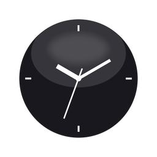

<p align="center">
  
</p>

<h1 align="center">Devin Orb</h1>

<p align="center">
  A floating orb widget for Windows that shows your Devin usage at a glance.
</p>

<p align="center">
  <a href="#quick-start">Quick Start</a> ·
  <a href="LICENSE">MIT License</a> ·
  <a href="README.zh-CN.md">中文文档</a>
</p>

<p align="center">
  
  
  
</p>

An obsidian-glass ball that lives at the edge of your screen, showing **Devin account usage**: daily quota / weekly quota / extra balance / billing period. A live clock sits inside the orb; the outer ring is a quota gauge.

## Features

- **Floating orb**: black glass ball, white clock hands, quota ring (green → amber → red as quota drains), breathing/hover/ripple animations
- **Usage panel**: click the orb to pop a glass card with quota bars and balance; spring entrance animation
- **Devin toast interception**: when Devin posts a Windows notification (session done, permission needed, question), the Windows banner is suppressed and the message appears as a speech bubble above the orb; the orb bounces and pulls out from the screen edge; click the bubble to bring Devin to the foreground
- **Edge docking**: drag the orb to a screen edge — it retracts into a half-circle after idle (quota ring still visible on the exposed edge); hover or click pulls it back out
- **Panel follows orb**: the panel tracks the orb live while dragging, docking, and retracting
- **Settings**: ring source (auto/daily/weekly), ring mode (remaining/used), theme (auto/light/dark), language (中文/English), refresh interval (5/10/50 min or custom minutes), launch with Devin, start on login

## Data source

Reads the same read-only endpoint the Devin client uses (`SeatManagementService/GetUserStatus`) — no enterprise service key required. Credentials come from your existing local sign-in, probed in order:

1. `%APPDATA%\devin\credentials.toml` (created by `devin auth login`)
2. Devin Desktop's `state.vscdb` (`windsurfAuthStatus`)

**Privacy**: all data is read and displayed locally only. The API key is never written to any project file, never logged, never sent anywhere. Settings live in `%APPDATA%\devin-orb\config.json`.

## Quick start

Download `DevinOrb-*-win-x64.zip` from [Releases](../../releases), unzip anywhere, run `DevinOrb.exe`.

Or run from source (Python 3.10+):

```bash
pip install -r requirements.txt
python app.py        # or pythonw app.py for background
```

## Controls

| Action | Result |
|---|---|
| Click | Open/close the usage panel |
| Double-click | Pin the panel above other windows |
| Drag | Move the orb; position persists; drops near an edge dock to that edge |
| Right-click | Open the settings drawer |
| Click bubble | Dismiss and raise Devin to the foreground |
| Tray icon | Left-click toggles the panel; right-click menu (open / settings / quit) |

## Project layout

```
app.py       # Qt orb + panel + speech bubble + animations + lifecycle
core.py      # credential discovery + GetUserStatus RPC + data normalization
config.py    # settings persistence / OpenUsage theme sync / autostart / Devin hook
notify.py    # event-driven toast interception (WinEvent + UI Automation), no polling
```

## License

MIT — see [LICENSE](LICENSE).
